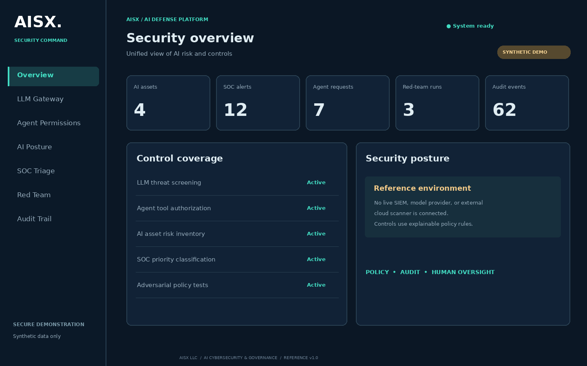

# AISX | AI Cybersecurity & Governance Platform

An integrated, demonstrable AI-security control plane combining **LLM input/output screening, AI agent authorization, AI security posture scoring, SOC alert triage, red-team regression tests and audit history** behind one authenticated dashboard.



> **Maturity:** Production-oriented reference implementation and private client-demo foundation. It is **not yet production-certified** and should not be used as the sole security control for real enterprise AI workloads. See [deployment and security runbook](docs/DEPLOYMENT_AND_SECURITY_RUNBOOK.md) for mandatory hardening gaps.

## Capabilities

| Module | What works now | Next enterprise integration |
|---|---|---|
| LLM Gateway | Explainable detection, redaction, metadata-only audit | Real proxy, model-aware classifier, DLP, benchmarks |
| Agent Permissions | Deny-by-default tool policy, independent approval record | Scoped expiring authorization tokens, tool executor |
| AI Posture | AI asset inventory, risk scoring, control findings | AWS/Azure/GCP inventory collectors, ongoing discovery |
| SOC Triage | Deterministic scoring, analyst-review requirement | SIEM/SOAR connectors, case management |
| Red Team | Five synthetic tests, test histories | Larger adversarial suites and LLM integration |
| Control plane | Roles, tenant IDs, Argon2 passwords, signed sessions, CSRF, security headers, PostgreSQL option, audit metadata | SSO/MFA, database RLS, WORM audit, distributed rate limits, observability |

## Quick start (local demo, not public Internet)

```bash
cp .env.example .env
# Replace the placeholders in .env with unique secure values
# Generate secrets: python -c "import secrets;print(secrets.token_urlsafe(48))"
docker compose up --build -d
# Open http://127.0.0.1:8080
```

Container stack: FastAPI + PostgreSQL, bound to `127.0.0.1:8080`. Local Python fallback uses SQLite. See the [complete setup instructions](docs/DEPLOYMENT_AND_SECURITY_RUNBOOK.md).

## Tests

```bash
pip install -r requirements-dev.txt
python -m pytest -q
```

Initial local automated run: **12 passed**. Docker image build, live PostgreSQL startup and external integrations have not yet been validated in the authoring environment.

## Suggested GitHub description (under 350 characters)

AISX enterprise AI cybersecurity & governance reference platform: secure LLM gateway, agent permissions with two-person approval, AI risk posture inventory, explainable SOC triage, automated red-team checks, audit events, RBAC dashboard, Docker and PostgreSQL deployment.

## Resume wording

**AI Cybersecurity & Governance Platform | Python, FastAPI, PostgreSQL, Docker, Defensive AI Controls** — Engineered a unified AI security demonstration platform with LLM screening, agent tool authorization and independent approvals, AI posture scoring, explainable SOC triage, repeatable red-team checks, role-enforced APIs, and auditable decision records. Implemented integration-ready interfaces and automated test coverage; documented remaining enterprise-production requirements.

## Responsible-use disclaimer

This repository provides defensive monitoring and policy examples only. It intentionally does not execute privileged tools, perform network scanning, or exfiltrate data. Safety-detection performance has not been independently measured. All sample records should be synthetic.

## License

Copyright © 2026 AISX LLC. See `LICENSE` for usage terms.

## Dashboard previews

The images in `screenshots/` are **illustrative renders of the implemented dashboard layout populated with synthetic data**. Browser screenshot capture could not be completed in the authoring environment, so the previews are not evidence of a deployed live browser session.
